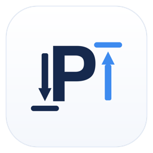

# AAE PO Suite

Turn customer purchase-order PDFs into checked, ready-to-send PO documents.

## Features

<table>
  <tr>
    <td width="33%" valign="top">
       
      <b>Flexible intake</b> 
      Drag and drop, a watched folder, or Outlook pickup from approved senders.
    </td>
    <td width="33%" valign="top">
       
      <b>Reads scans</b> 
      Scanned PDFs and images are read on your computer. Multi-order PDFs are split.
    </td>
    <td width="33%" valign="top">
       
      <b>Checks every order</b> 
      Vendor and price matching, totals, revisions and ship-to, with a clear reason when something needs review.
    </td>
  </tr>
  <tr>
    <td width="33%" valign="top">
       
      <b>Your PO form</b> 
      Excel and PDF output from your own template, plus one combined spreadsheet per run.
    </td>
    <td width="33%" valign="top">
       
      <b>Microsoft 365 email</b> 
      Sends from your own mailbox with a saved subject and message, only when you click Send.
    </td>
    <td width="33%" valign="top">
       
      <b>Master data history</b> 
      Every price list and vendor list version is kept and can be compared.
    </td>
  </tr>
</table>

## Download

| Platform              | File                                                            |
| --------------------- | --------------------------------------------------------------- |
| Windows               | `AAE-PO-Suite-Setup-<version>.exe`                              |
| Windows (portable)    | `AAE-PO-Suite-<version>.exe`                                    |
| macOS (Apple silicon) | `AAE-PO-Suite-<version>-arm64.dmg`                              |
| Linux                 | `AAE-PO-Suite-<version>.AppImage` or `poex_<version>_amd64.deb` |

All files are on the [latest release](https://github.com/Dry1ceD7/poex-releases/releases/latest), with SHA-256 checksums.

## Installation

The builds are not code-signed yet, so the first launch asks for confirmation.

- **Windows:** run the installer. On the SmartScreen prompt, select **More info**, then **Run anyway**.
- **macOS:** drag the app into Applications and open it. If it is blocked, go to **System Settings > Privacy & Security** and select **Open Anyway**.
- **Linux:** run the AppImage after `chmod +x`, or install with `sudo apt install ./poex_<version>_amd64.deb`.

## Requirements

| Platform | Requirement                                                     |
| -------- | --------------------------------------------------------------- |
| Windows  | Windows 10 or 11, 64-bit                                        |
| macOS    | macOS 12 or later on Apple silicon                              |
| Linux    | 64-bit x86, Debian or Ubuntu for the `.deb`                     |
| Email    | Microsoft 365 work account, approved once by your administrator |

## Updates

The app checks for a new version at startup and every six hours, and either installs it when you quit or links you to the download. See the [release notes](https://github.com/Dry1ceD7/poex-releases/releases) for what changed.

## Roadmap

| Status  | Item                                                   |
| ------- | ------------------------------------------------------ |
| Next    | Signed Windows and macOS builds that update themselves |
| Planned | Highlighting of values read from scanned pages         |

## License

Proprietary. All rights reserved.
